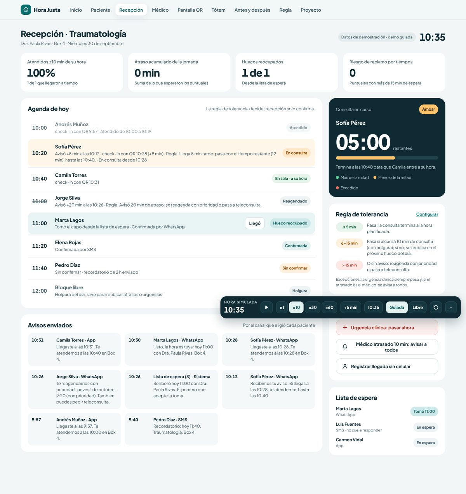
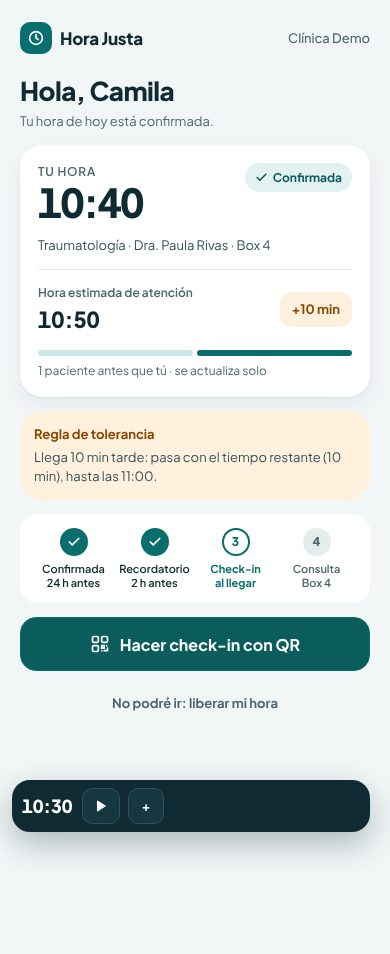
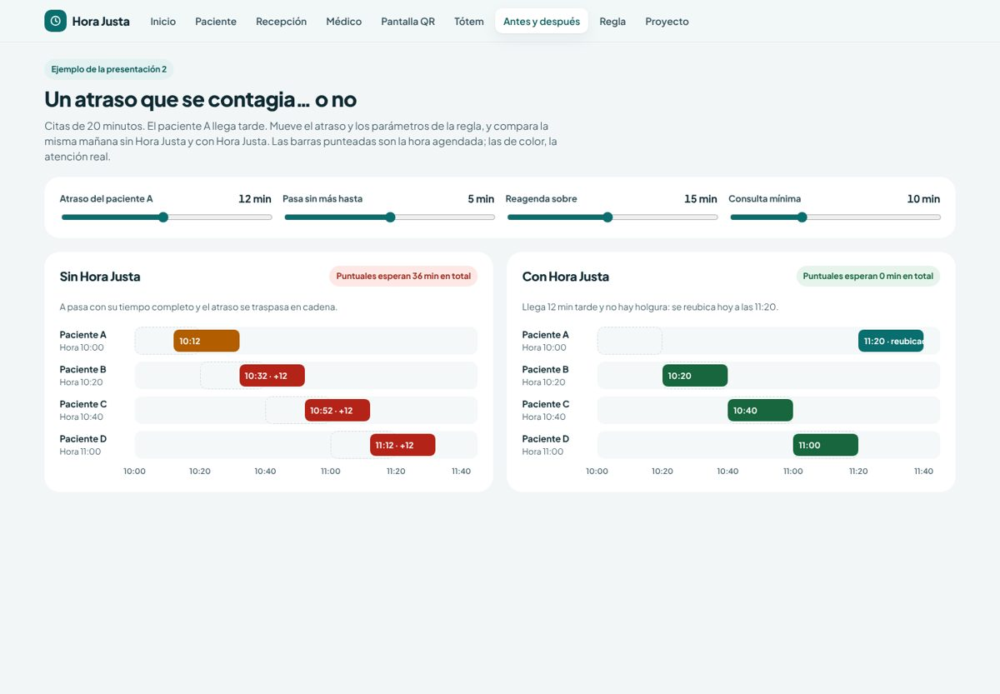

# Hora Justa · Salud Sin Espera

> **Nadie que llega a su hora espera por el atraso de otro.**

Prototipo funcional de **Hora Justa**, el proyecto del ramo **Taller de Transferencia Tecnológica** (UNAB) del equipo
Benjamín Zúñiga, Diego Jorquera y Mario Lamilla, con el profesor Mauricio Pizarro Leyton.

Hora Justa gestiona el **atraso dentro de la consulta**: una regla de tolerancia decide qué pasa cuando alguien llega
tarde, el médico ve un cronómetro-semáforo, los pacientes que siguen reciben su nueva hora y los huecos se ofrecen
solos a la lista de espera.



---

## El problema

En clínicas y centros de salud el paciente espera sin saber cuánto falta, los turnos se manejan a mano y **el atraso
de uno se traspasa en cadena** a los que llegaron a la hora. Con citas de 20 minutos, si el paciente de las 10:00 llega
12 minutos tarde y se le atiende igual, los de las 10:20, 10:40 y 11:00 esperan 12 minutos cada uno. Termina en
reclamos, aunque la atención médica sea buena. No es solo culpa del paciente: es una falla del proceso operacional.

| | |
|---|---|
| **Cliente (paga)** | Clínicas privadas multiespecialidad; en una segunda etapa, centros públicos y CESFAM |
| **Usuarios** | Pacientes (confirman, avisan su atraso, ven su turno), médicos (cronómetro) y recepción |
| **Mercado** | Institucional, regulado, SaaS; parte en Santiago con potencial regional |
| **Early adopters** | Clínicas de 2 a 5 sucursales con quejas por tiempos y agenda digital |

## Vigilancia tecnológica

| Región | Soluciones revisadas | Lo que adopta Hora Justa |
|---|---|---|
| Estados Unidos | Epic Fast Pass, LeanTaaS iQueue, Clockwise.MD | Lista de espera automática y holguras calculadas con datos |
| Europa | Doctolib, NHS · DrDoctor, Qmatic | Aviso automático del atraso y check-in autónomo |
| Japón / China | iTICKET, práctica de puntualidad, franjas de 30 min, IA de pre-consulta | Política de puntualidad explícita y pre-consulta digital |
| Chile | Hospital Digital, Keirón, TeleSalud, Hora Salud | **Oportunidad:** no encontramos una solución local que gestione en tiempo real el atraso dentro de la consulta |

Algunos datos: en especialidades, la inasistencia en Chile fue de 15,6% en 2022 (Muñoz, 2024); en los CESFAM de la
comuna de Antofagasta se perdieron 271 mil citas en 2025 (CMDS, 2026); en Japón la espera es el ítem peor evaluado de
la consulta externa, con 25,5% de insatisfechos (MHLW, 2025). Las fuentes completas están en la pantalla **Proyecto**.

## La regla de tolerancia

| Si ocurre… | Hora Justa… | Así evita… |
|---|---|---|
| Llega hasta 5 min tarde | Pasa; la consulta termina a la hora planificada | El atraso en cadena |
| Llega 6–15 min tarde y alcanza la consulta mínima (10 min) | Pasa con el tiempo restante, o usando la holgura libre que haya después | Gastar la holgura a ciegas |
| Llega 6–15 min tarde, sin holgura | Se reubica en el próximo hueco del mismo día | Que el puntual espere |
| Más de 15 min o sin aviso | Reagenda con prioridad o teleconsulta; su hora va a la lista de espera | Reclamos por cambio de hora |
| Urgencia clínica | Siempre pasa: decide el médico y queda registrado | Riesgo para el paciente |
| El atrasado es el médico | Avisa la nueva hora a todos y ofrece reagendar | La espera sin información |

Los umbrales son referenciales: cada clínica los configura por especialidad (pantalla **Regla**). La lógica está en
[`src/engine/regla.ts`](src/engine/regla.ts) y tiene pruebas en [`src/engine/simular.test.ts`](src/engine/simular.test.ts).

## Cómo llega el paciente

1. **Antes:** al confirmar la hora (24 h antes) recibe por WhatsApp o SMS un **link único** de su cita
   (`#/c/7KQ2-M9`). Se abre en el navegador, sin app ni contraseña, y muestra solo hora, especialidad, médico y box.
   Desde ahí confirma, cancela o avisa “voy atrasado”. Recibe un recordatorio 2 h antes.
2. **Al llegar:** escanea el **QR de la pantalla de la entrada**, que cambia cada 30 segundos, para que la hora de
   llegada sea real y no se pueda marcar desde la casa. Si su celular tiene el link abierto, el check-in es automático.
3. **Sin celular:** usa el **tótem** con los últimos 4 dígitos del RUT, o recepción marca su llegada.
4. **En la consulta:** el médico ve el cronómetro-semáforo; los que siguen ven su hora estimada actualizada.
5. **Después:** si alguien cancela o se reagenda, su hora se ofrece a la lista de espera y el primero que acepta la toma.

<p>
  
  
</p>

## Pantallas del prototipo

| Ruta | Pantalla | Qué muestra |
|---|---|---|
| `#/` | Inicio | Acceso a todo y guía de la demo |
| `#/c/<token>` | Paciente | Link único: hora, hora estimada, recorrido, check-in con QR, voy atrasado |
| `#/recepcion` | Recepción | Agenda en vivo con las decisiones de la regla, avisos enviados, lista de espera, métricas y acciones |
| `#/medico` | Médico | Cronómetro-semáforo, quién sigue, aviso de atraso y urgencias |
| `#/entrada` | Pantalla QR | QR de check-in que cambia cada 30 s |
| `#/totem` | Tótem | Check-in con RUT para quien no usa celular |
| `#/simulacion` | Antes y después | El ejemplo de la presentación 2, sin y con Hora Justa |
| `#/regla` | Regla | Los seis escenarios, un probador y la configuración |
| `#/proyecto` | Proyecto | Problema, vigilancia, Lean Canvas y fuentes |

## Cómo hacer la demo

- **Demo guiada:** en Inicio, “Ir directo a las 10:35”. Sofía avisó y llegó 8 min tarde: pasa solo hasta las 10:40,
  así Camila entra a su hora. Jorge avisó 20 min: se reagenda y Marta toma su hora desde la lista de espera.
  Elena llega sin celular y Pedro nunca confirma.
- **Modo libre:** en el control de abajo a la derecha, elige “Libre”. Todos llegan a la hora menos Camila, que la manejas
  tú desde su link (`#/c/7KQ2-M9`).
- El reloj simulado se controla con play/pausa, velocidades ×1 a ×60 y “+5 min”.
- Abre varias pestañas (recepción, médico, paciente): se sincronizan solas.

## Métricas (las del Lean Canvas)

- % de pacientes atendidos ±10 min de su hora (entre los que llegaron a tiempo)
- Atraso acumulado de la jornada
- Huecos reocupados desde la lista de espera
- Riesgo de reclamo: puntuales con más de 15 min de espera

## Correr el proyecto

```bash
npm install
npm run dev      # desarrollo
npm test         # pruebas de la regla y la simulación
npm run build    # versión para publicar (carpeta dist/)
```

Hecho con React 18, TypeScript y Vite. Se publica solo en GitHub Pages con el workflow de `.github/workflows`.

### Estructura

```
src/
  engine/        lógica pura y probada
    regla.ts       regla de tolerancia
    simular.ts     simulación de la jornada (agenda, lista de espera, avisos, métricas)
    escenario.ts   jornada de demostración y ejemplo de la presentación 2
  views/         una pantalla por archivo
  components/    piezas compartidas (marca, control de la demo, íconos)
  store.ts       estado compartido entre pestañas (localStorage)
  checkin.ts     código del QR de la entrada (cambia cada 30 s)
```

## Límites del prototipo y siguientes pasos

Es un prototipo para validar la idea, no un sistema en producción:

- **Datos ficticios:** todos los nombres, RUT y la clínica son inventados.
- **Sin backend:** el estado vive en el navegador y se sincroniza entre pestañas del mismo navegador. Para probarlo con
  el celular de un visitante hace falta un servidor en tiempo real (por ejemplo, Supabase).
- **Sin envíos reales:** los WhatsApp y SMS se simulan en el panel de avisos.
- **Sin integración** con la agenda o el sistema clínico de una clínica real.
- **Privacidad:** el diseño evita datos clínicos en el link del paciente, en línea con la Ley 20.584 y la Ley 21.719,
  pero una versión real requiere una evaluación formal.

El siguiente paso propuesto es un **piloto de 8 semanas** en una especialidad, midiendo las cuatro métricas para
ajustar los umbrales de la regla y el precio.

---

Taller de Transferencia Tecnológica · Universidad Andrés Bello · 2026
